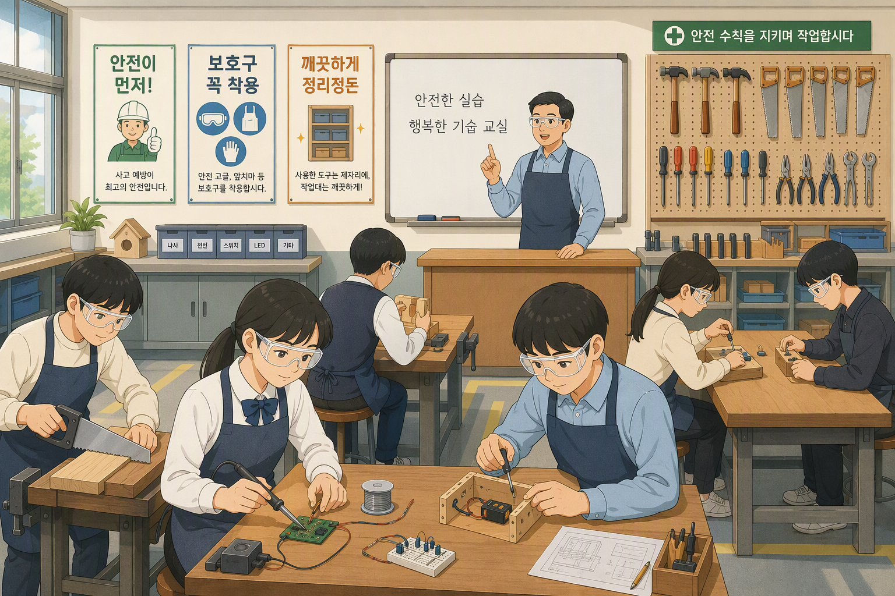
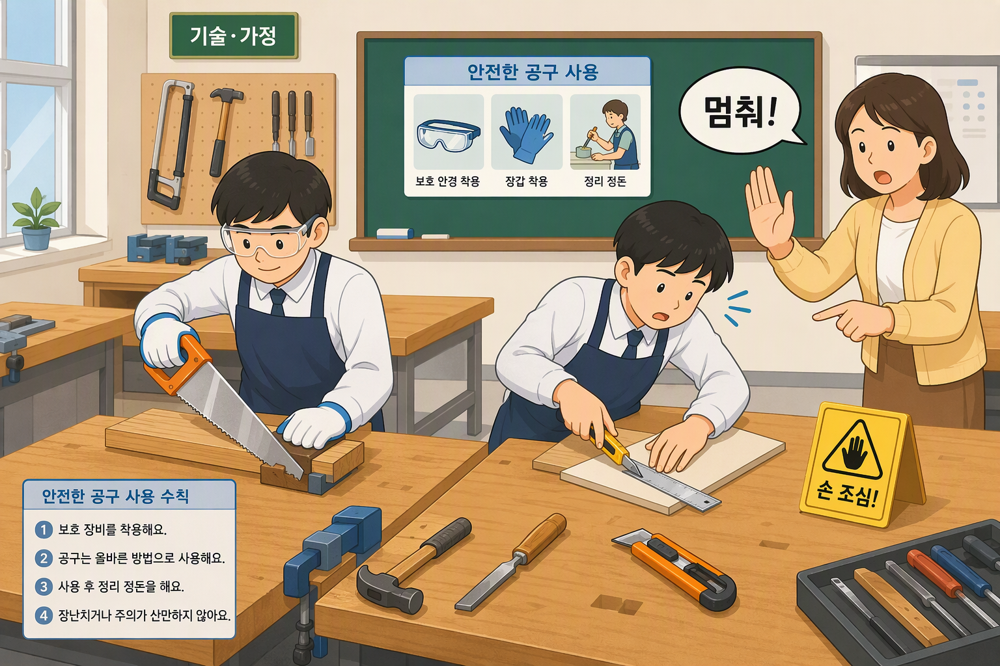
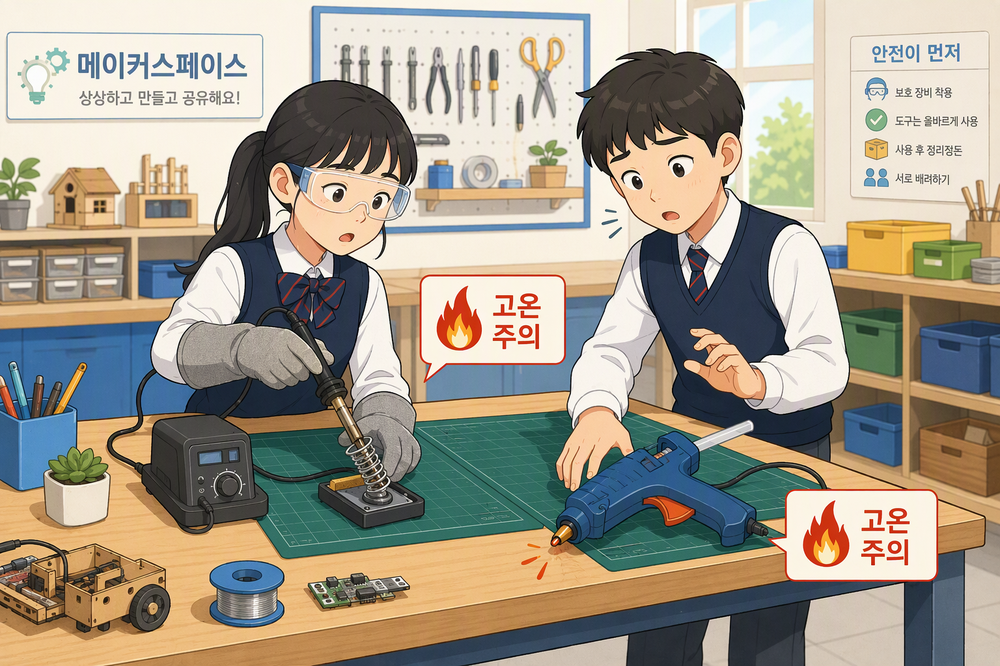
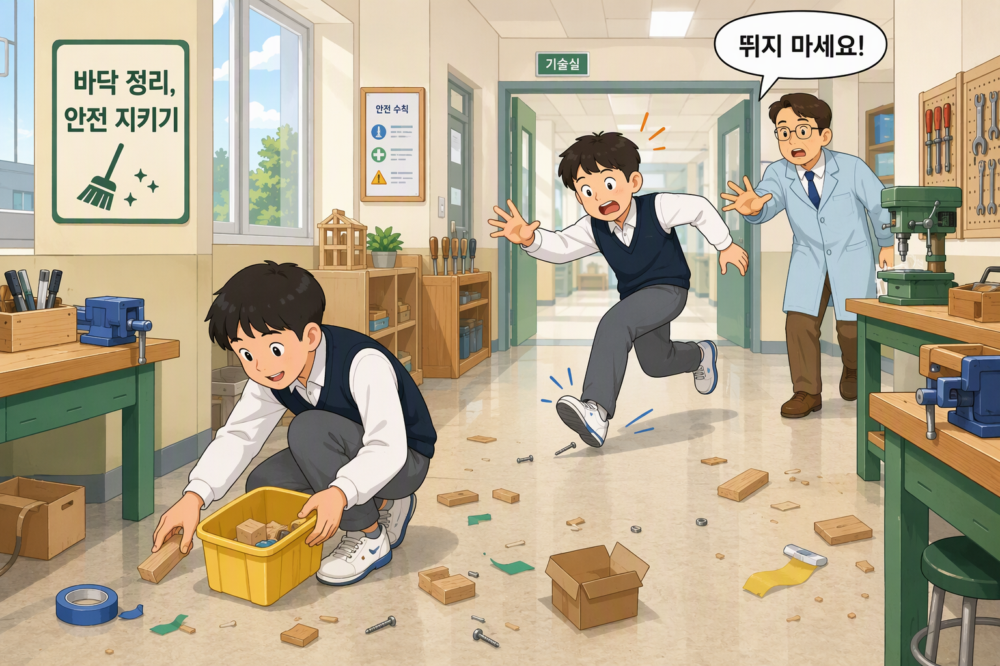
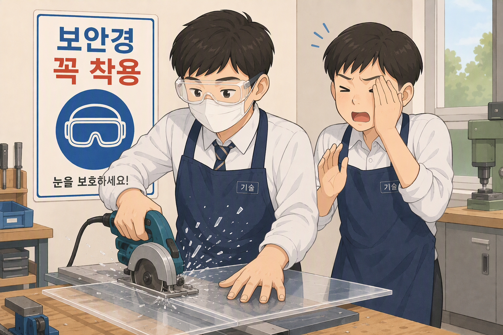
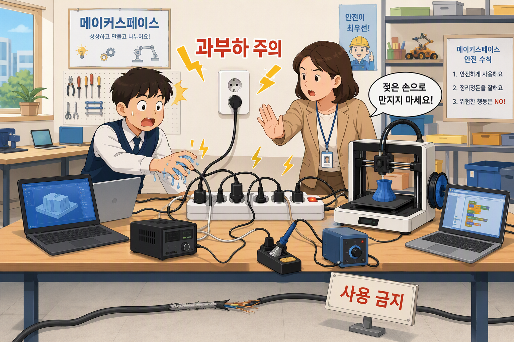
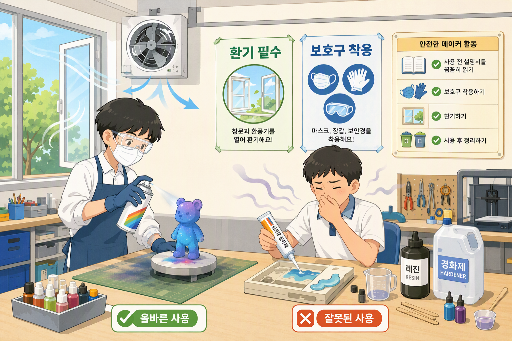
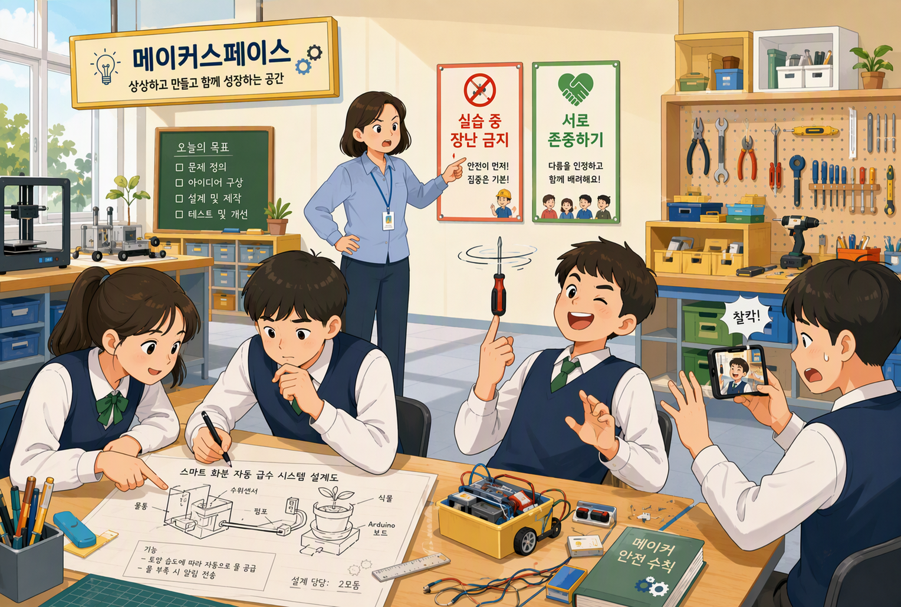
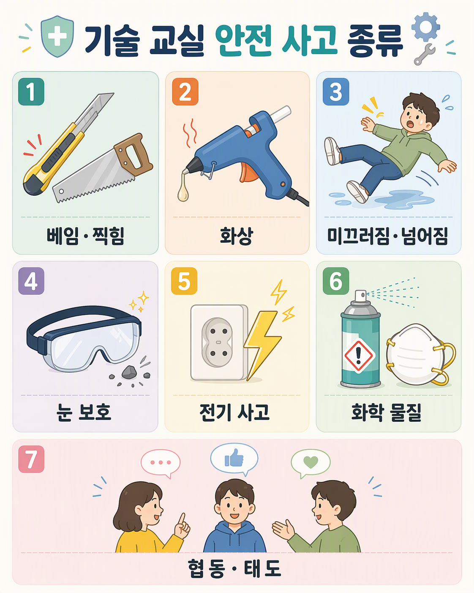

# 기술실 안전사고 유형별 예방 가이드

> 중학교 기술실·무한상상실·메이커실 수업용 자료.
> 관련 사진: `public/images/safety-helper/` 폴더의 `accident-*.jpg/png` 파일.
> 이 문서의 사진은 실습실 안전 도우미 앱의 점검·퀴즈와 연결됩니다.

중학교 기술실·무한상상실·메이커실에서의 안전사고는 공식 통계가 “공간별 세부 랭킹”으로 잘 쪼개져 있지 않아,
일반적인 학교 실습실(기술·가정, 과학실, 공작실, 메이커실 등) 사고 자료와 학교 안전 지침을 종합해서 설명해야 합니다.
아래 순위는 “발생 가능성과 빈도” 기준의 일반적인 경향이라고 이해하면 됩니다.

1위: 공구·기계 사용 중 베임·찍힘·끼임 사고

대표 사례

목공톱, 커터칼, 조소칼, 니퍼, 가위 등으로
손가락 베임, 손톱·피부 일부 절단
글루건 끝, 인두기, 3D펜 팁 등에
손가락이 닿아 화상 또는 수포
드릴, 톱, 절단기 주변에서
회전부에 장신구·옷·머리카락이 끼이는 끼임 사고 (경미~중상까지 다양)
왜 가장 많나?

실습의 대부분이 “만지면서 만드는 활동”​이라 공구 사용 빈도가 매우 높음
도구 사용 경험이 적고, ‘조금만 더 힘주면 되겠지’ 하는 무리한 동작이 많음
보호장비(장갑, 고글)를 착용하지 않는 경우가 많음
✅ 예방 수칙 (수업 전 점검과 연결)

- 절단 방향 앞에 손·손가락을 두지 않기 (톱·커터·니퍼 공통)
- 장신구 빼기, 소매 걷기, 긴 머리 묶기 (회전부 끼임 방지)
- 작업용 장갑·보안경 착용 후 시작하기
- → 앱 점검 항목: 수업 전 복장 확인, 수업 중 올바른 공구 사용
2위: 화상 사고 (뜨거운 도구·재료, 전기·화학 관련)

대표 사례

글루건, 인두기, 납땜 인두, 3D 프린터 노즐에 살짝 닿아
1도~2도 정도의 경미한 화상
가열되는 모터, 전원 어댑터, 전선 단락 등에서
국소적인 화상 또는 화재 직전 상황
실험용 알코올램프, 버너 사용 시
손/팔 화상, 책상 위 물건이 타기 시작하는 사고
특징

“잠깐만 놔두면 되겠지” 라고 생각하고
뜨거운 상태의 도구를 아무 데나 내려놓았다가
본인 또는 다른 친구가 손을 대면서 발생
안전안내가 있어도, 도구의 온도·위험성이 체감이 잘 안 되는 나이라 자주 발생
✅ 예방 수칙

- 뜨거운 도구는 지정된 받침대(인두 받침대 등)에만 두기
- "잠깐"이라도 아무 데나 내려놓지 않기 (다음 친구가 만질 수 있음)
- 3D펜·글루건 사용 후 노즐이 식을 때까지 손대지 않기
- → 앱 점검 항목: 수업 후 공구 정리·전원 차단 확인
3위: 미끄러짐·넘어짐·부딪힘(추락 포함)

대표 사례

공작 활동 후 바닥에 남은
톱밥, 나사, 재료 조각, 접착제, 물, 실리콘 등으로 미끄러져 넘어짐
의자 위·책상 위에 올라가 전시물 설치, 촬영, 천장 근처 작업을 하다가
떨어져 발목·무릎·손목 삠, 타박상
도면, 재료를 가지러 급하게 뛰다가
친구, 책상 모서리, 문에 부딪혀 타박상·찢어짐
특징

특히 메이커실/무한상상실처럼 복도형 레이아웃에
가방, 박스, 공구 박스 등이 통로에 쌓여 있으면 충돌·넘어짐 위험 증가
“시간 없다, 빨리!” 분위기일수록 빈도 급증
✅ 예방 수칙

- 톱밥·나사·재료 조각은 그때그때 쓸어담기 (바닥에 두지 않기)
- 통로에 가방·박스·공구 상자 쌓지 않기
- 높은 곳 작업은 의자 대신 안전한 발판 사용, 2인 1조로 하기
- → 앱 점검 항목: 수업 전후 작업대·바닥 정리
4위: 이물질·파편에 의한 눈·피부 손상

대표 사례

목재·아크릴·플라스틱 절단 시
작은 파편이 튀어 눈에 들어감 (각막 손상 위험)
3D 프린터, 레이저 커터, 전동 공구 주변에서
미세분진, 연기, 악취를 장시간 흡입
금속·플라스틱 샤프 엣지(날카로운 모서리)에 피부가 긁혀
찰과상·가벼운 출혈
특징

보호안경을 쓰지 않거나,
“귀찮아서 안경 위로 잠깐만 작업”하다가 발생
사고가 나도 “눈에 뭐 조금 들어갔다가 말았어요” 하고 넘겨 버리기 쉬워
실제 발생 건수는 표면 통계보다 더 많을 가능성이 큼
✅ 예방 수칙

- 절단·연마 작업 전 보안경은 필수 (“잠깐만”도 예외 없음)
- 3D프린터·레이저커터 사용 시 환기 + 마스크 착용
- 눈에 뭐가 들어가면 비비지 말고 선생님께 바로 알리기
- → 앱 퀴즈 연계: 보안경·마스크 관련 문항으로 복습
5위: 전기 감전·전기 쇼트(합선) 사고

대표 사례

전선 피복이 벗겨진 부분을 손으로 만지거나
젖은 손으로 플러그/콘센트를 만져 경미한 감전
회로 실습 중 잘못된 배선·과전류로
스파크 발생, 퓨즈 나감, 부품 파손
노트북·3D 프린터·레이저커터 등을
멀티탭에 과다 연결해 발열·탄내·연기 발생
특징

‘전기’라는 특성 때문에 기관(학교·교육청) 통제와 점검이 상대적으로 엄격해서
빈도는 상대적으로 낮은 편이지만, 한번 발생하면 위험도가 높음
대부분 “깜짝 놀람+가벼운 감전” 수준이 많고, 중대사고는 드물게 나타남
✅ 예방 수칙

- 젖은 손으로 플러그·콘센트 만지지 않기
- 멀티탭 한 구에 여러 고용량 기기 꽂지 않기 (과부하 주의)
- 전선 피복이 벗겨진 공구는 "사용 금지" 표시 후 선생님께 보고
- → 앱 점검 항목: 수업 후 전원 차단·콘센트 정리 확인
6위: 화학물질·소재 취급 부주의
(메이커실/무한상상실에서 점점 늘고 있는 유형)

대표 사례

스프레이 접착제, 락카, 페인트, 실리콘, 레진 등을
환기 불충분한 공간에서 사용해 두통·호흡기 자극
레진 작업, 3D 프린터 수지, 세척용 용제 등을
맨손으로 만지거나 피부에 묻힌 채 방치 → 피부염, 알레르기 반응
레이저커팅 시 PVC류(염소계 플라스틱) 재료를 잘못 사용해
유해가스 발생(기침, 목 통증 등)
특징

항목 자체가 아직 “새로운 활동 분야”라
학교·교사가 정확한 안전 가이드와 설비(국소 배기, 보호장비)를
완전히 갖추지 못한 경우가 있어서 위험성이 잠재적으로 큼
✅ 예방 수칙

- 스프레이·레진·용제는 반드시 환기되는 곳에서 사용
- 맨손 접촉 금지 — 니트릴 장갑 + 보안경(고글) 착용
- 레이저커터에는 PVC(염소계) 재료 넣지 않기 (유해가스 발생)
- 사용 후 뚜껑 닫고 지정 장소에 보관, 손 씻기
- → 앱 퀴즈 연계: 환기·보호구 관련 문항으로 복습
7위: 정신적 스트레스·심리적 사고(갈등, 따돌림 등)

눈에 잘 안 보이지만, 메이킹·프로젝트 수업에서 조별 갈등, 왕따, 언어폭력, 과도한 성과 압박 등이
학생 안전에 영향을 미칠 수 있습니다.

결과물 파손, 실패 시
서로 책임 전가, 말다툼, 물리적 충돌
실습 중 장난(공구 던지기, 놀리기, 사진·영상 촬영 후 조롱)으로
심리적 피해, 이후 수업 불참·불안감 유발

요약 정리 (빈도 기준 추정 순위)
1. 공구·기계 사용 중 베임/찍힘/끼임
2. 뜨거운 도구·재료로 인한 화상
3. 미끄러짐·넘어짐·부딪힘(추락 포함)
4. 파편·먼지·연기 등으로 인한 눈·피부·호흡기 손상
5. 전기 감전·합선·발열 사고
6. 화학물질·소재(레진, 스프레이 등) 관련 건강 피해
7. 프로젝트 활동 중 갈등·스트레스 등 심리적 사고

## 수업 활용 방법

1. 수업 시작 전: 실습실 안전 도우미 앱에서 **실습실 안전점검** 체크리스트 수행
2. 사고 유형 학습: 위 순위별 사진과 함께 "우리 실습실에서 일어날 수 있는 상황인가?" 토론
3. 점검 후: **안전 퀴즈**(24문항)로 이해도 확인 → 결과는 선생님 시트로 자동 전송
4. 교실 게시: `poster-tech.jpg` / `poster-imagine.jpg` / `poster-maker.jpg`를 인쇄해 각 실에 부착
